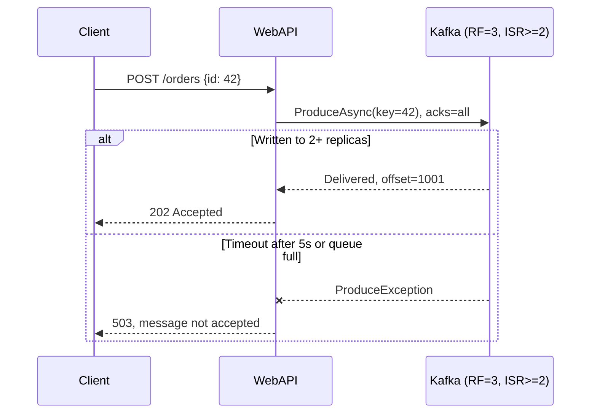
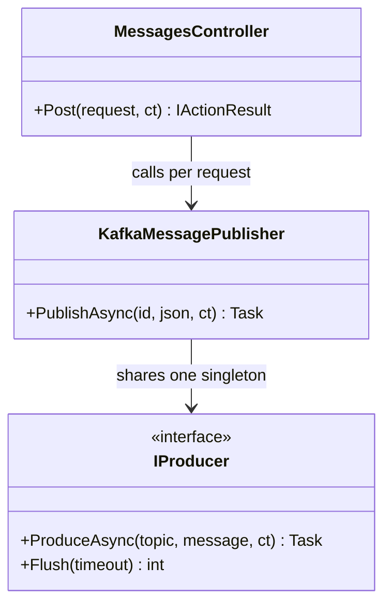
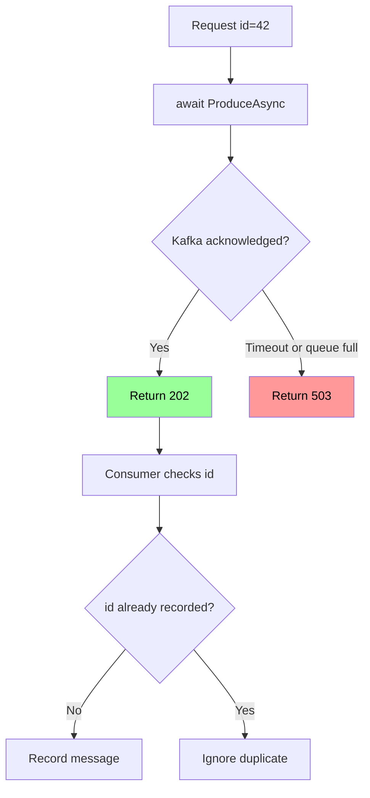

# الإرسال المباشر إلى Kafka بـ await ProduceAsync

## الخطوات

1. أنشئ `IProducer` واحداً كـ Singleton يشاركه كل الطلبات، حتى تجتمع رسائلها في batches.
2. اضبط المنتج: `acks=all`، `enable.idempotence=true`، `linger.ms=5`، `message.timeout.ms=5000`.
3. اضبط الـ topic: `replication.factor=3` و`min.insync.replicas=2`.
4. داخل الطلب، نفّذ `await ProduceAsync` بمفتاح ثابت هو `id` الرسالة.
5. عند التأكيد، أرجع `202 Accepted`.
6. عند timeout أو امتلاء الطابور، أرجع `503`، فالرسالة لم تُقبل.
7. عند إيقاف الخدمة، نفّذ `producer.Flush()` لإكمال ما في الذاكرة.
8. عند المستهلك، تجاهل أي `id` سبق تسجيله، لأن فقدان التأكيد قد يسبب تكراراً.

## Sequence Diagram


*لاحظ: 202 لا يصل إلا بعد تأكيد Kafka.*

## Class Diagram


*لاحظ: يوجد منتج واحد لكل الطلبات، وهو أساس الـ batching.*

## Flowchart


*لاحظ: كل مسار ينتهي برد واضح، فلا يوجد نجاح بلا تأكيد.*

## مثال

الافتراض: 5,000 رسالة/ثانية، و`linger.ms=5`. الأرقام محسوبة، وليست قياساً على Kafka.

```
حجم الدفعة   = 5,000 × 0.005s = 25 رسالة
عدد الدفعات  = 5,000 ÷ 25     = 200 دفعة/ثانية
```

| الحدث | الرسائل المؤكدة المفقودة | ما يراه العميل |
|---|---|---|
| Crash للـ API | 0 | خطأ اتصال للطلبات المعلقة |
| تعطل broker واحد | 0 | زمن أعلى لفترة قصيرة أثناء تبديل الـ leader |
| تعطل brokerين من 3 | 0 | `503` |
| ❌ `Produce` بلا فحص النتيجة، مع 100ms في الذاكرة | حتى 500 (5,000 × 0.1) | `202` لرسائل ضاعت |

## تطبيقات مشابهة

- **Confluent Cloud (الولايات المتحدة):** توثيقه يوصي بنفس ضبط المتانة: `RF=3` و`min.insync.replicas=2` و`acks=all`. [المرجع](https://docs.confluent.io/cloud/current/client-apps/optimizing/durability.html)
