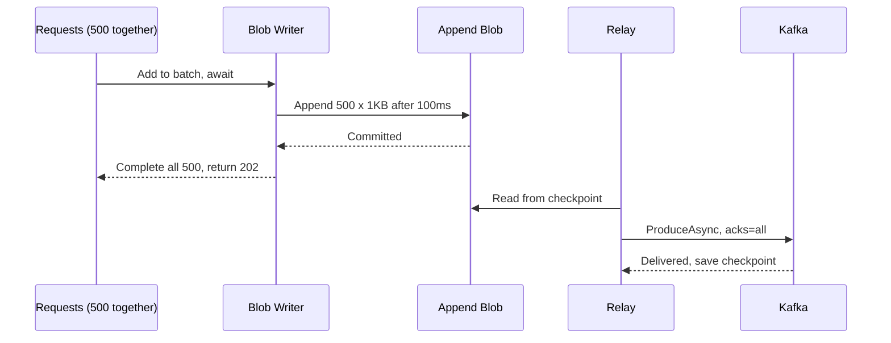
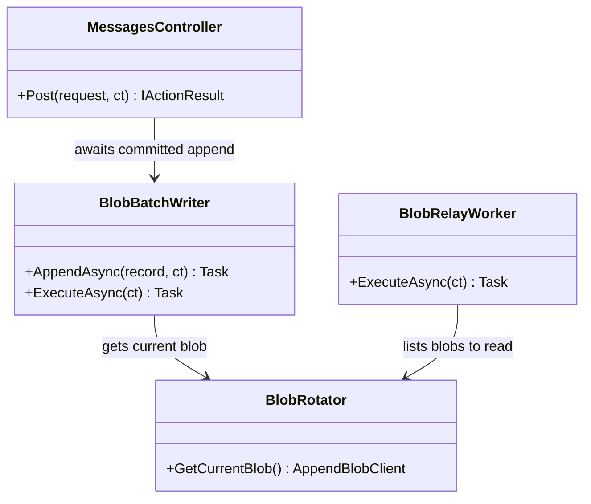
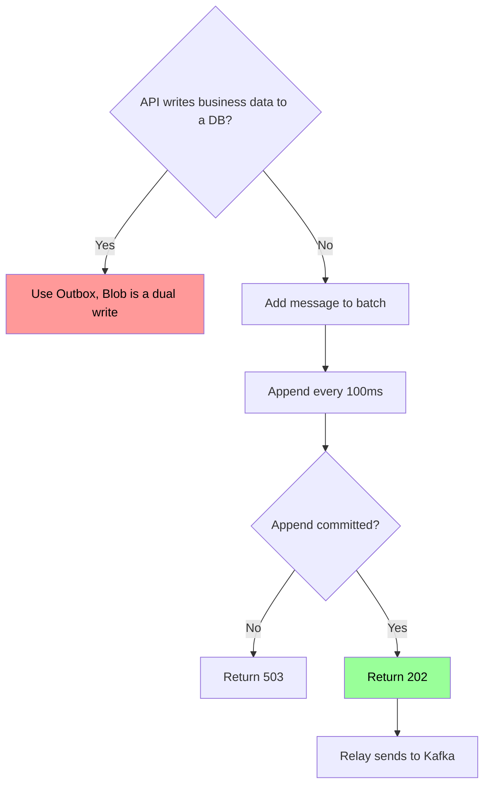

# كتابة Stream على Blob

## الخطوات

1. استخدم هذا الحل فقط إذا كان الـ API يمرر الرسالة بلا بيانات عمل في DB. مع بيانات العمل، يبقى Outbox هو الحل، لأن Blob خارج الـ transaction.
2. خصص لكل instance ملف Append Blob خاصاً بها، مثل `messages/{instance}/{timestamp}.log`.
3. يضع الطلب رسالته في دفعة بالذاكرة، ثم ينتظر بـ `await`.
4. كل 100ms، يرسل كاتب واحد الدفعة كعملية Append واحدة.
5. بعد نجاح Append، تحصل كل طلبات الدفعة على `202`. وعند فشله، تحصل على `503`.
6. افتح blob جديداً قبل بلوغ حد 50,000 append.
7. يقرأ Relay كل blob من الـ checkpoint ويرسل إلى Kafka بـ `acks=all`، ثم يحفظ الـ checkpoint.
8. إذا توقفت instance، يكمل Relay آخر قراءة blobs الخاصة بها.
9. احذف الـ blobs المرسلة عبر سياسة lifecycle.
10. عند المستهلك، تجاهل أي `id` سبق تسجيله، وتحمّل عدم ترتيب الرسائل بين instances.

## Sequence Diagram


*لاحظ: العميل ينتظر حتى 100ms مع زمن الشبكة، مقابل نسخة خارج السيرفر.*

## Class Diagram


*لاحظ: `BlobRotator` يخفي حد 50,000 append عن بقية النظام.*

## Flowchart


*لاحظ: أول قرار هو هل توجد بيانات عمل، لا كيف نكتب إلى Blob.*

## مثال

الافتراض: 5,000 رسالة/ثانية، و1KB للرسالة، وinstance واحدة. الأرقام محسوبة، وحد 50,000 من توثيق [Azure](https://learn.microsoft.com/en-us/rest/api/storageservices/understanding-block-blobs--append-blobs--and-page-blobs).

```
رسائل كل Append  = 5,000 × 0.1s    = 500 رسالة (~500KB)
عمليات Append    = 1 ÷ 0.1s        = 10/ثانية
blob جديد كل     = 50,000 ÷ 10     = 5,000s ≈ 83 دقيقة
النمو اليومي     = 5,000 × 86,400 × 1KB = 432GB
```

| الحدث | ملف محلي | Blob |
|---|---|---|
| تلف قرص الـ instance | ❌ يفقد غير المرسل | 0 مفقود |
| توقف instance نهائياً | ملفها عالق | أي Relay يكمل |
| تعطل Kafka | يتراكم | يتراكم |
| الانتظار قبل 202 | ~5ms مقاسة | حتى 100ms + زمن الشبكة |

❌ لا يوفر S3 Standard عملية append، فتصبح كل دفعة object مستقلاً.

## تطبيقات مشابهة

- **WarpStream (الولايات المتحدة):** لا يؤكد عملية Produce إلا بعد حفظ الدفعة في object storage. يعلن زمناً قدره p50 250ms وp99 500ms عند batch افتراضي 250ms على S3 Standard. [مسار الكتابة](https://docs.warpstream.com/warpstream/overview/architecture/write-path)، [الزمن](https://docs.warpstream.com/warpstream/kafka/advanced-agent-deployment-options/low-latency-clusters)
