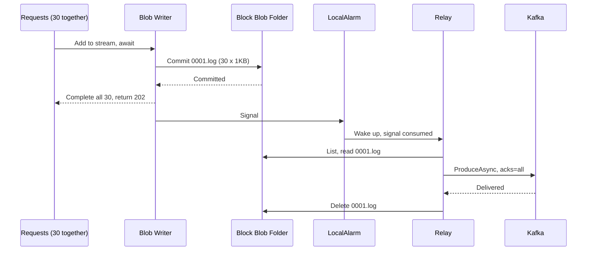
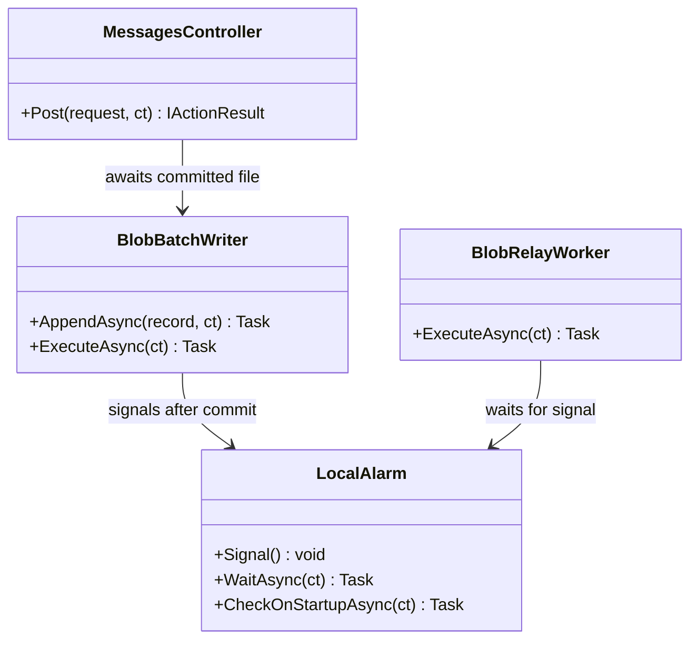
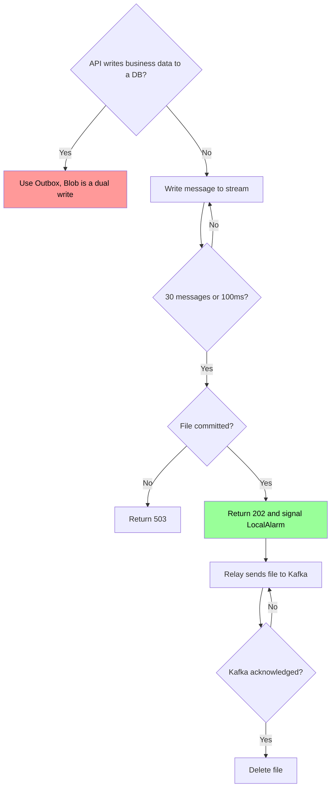

# كتابة Stream على Blob

## الخطوات

1. استخدم هذا الحل فقط إذا كان الـ API يمرر الرسالة بلا بيانات عمل في DB. مع بيانات العمل، يبقى Outbox هو الحل، لأن Blob خارج الـ transaction.
2. خصص لكل instance مجلداً، واكتب كل دفعة في Block Blob مستقل، مثل `messages/{instance}/{timestamp}-{seq}.log`.
3. تمر كل الطلبات عبر طابور واحد وكاتب واحد، وينتظر كل طلب بـ `await`.
4. يكتب الكاتب الرسائل في Stream الملف، ويسكره عند 30 رسالة أو 100ms، أيهما أول.
5. بعد نجاح الـ Commit، تحصل كل طلبات الملف على `202`. وعند فشله، تحصل على `503`.
6. بعد كل Commit، يرسل الكاتب إشارة إلى `LocalAlarm` في الذاكرة، فيوقظ الـ Relay.
7. عند التشغيل، يعمل `LocalAlarm` عملية List على المجلد، وإذا وجد ملفات يوقظ الـ Relay.
8. يستهلك الـ Relay الإشارة قبل القراءة، ثم يقرأ الملفات واحداً واحداً، ويرسل كل ملف إلى Kafka بـ `acks=all`.
9. بعد تأكيد Kafka فقط، يمسح الـ Relay الملف. وجود الملف يعني أنه لم يُرسل، فلا حاجة إلى cursor.
10. إذا تعطل Kafka، يعيد الـ Relay المحاولة بنفسه، ولا يعود لانتظار الإشارة.
11. إذا توقفت instance نهائياً، يكتشف Relay آخر مجلدها بفحص بطيء كل 5s، ويأخذ lease عليه، ثم يكمل إرسال ملفاتها.
12. عند المستهلك، تجاهل أي `id` سبق تسجيله، وتحمّل عدم ترتيب الرسائل بين instances.
13. عند التنفيذ، استخدم المحاكي `mcr.microsoft.com/azure-storage/azurite` بدل Azure الحقيقي. زمن الاستجابة عليه لا يمثل زمن Azure.

## Sequence Diagram


*لاحظ: `202` يأتي بعد الـ Commit، والمسح يأتي بعد تأكيد Kafka.*

## Class Diagram


*لاحظ: `LocalAlarm` يقرر متى يستيقظ الـ Relay، والملفات في Blob هي مصدر الحقيقة.*

## Flowchart


*لاحظ: الملف لا يُمسح إلا بعد التأكيد، فالفشل يؤدي إلى إعادة الإرسال لا إلى الفقد.*

## مثال

الافتراض: 1KB للرسالة، وinstance واحدة. الأرقام محسوبة، وليست قياساً على Azure.

```
messages/instance-1/
├─ 0001.log   مسكر، 30 رسالة (30KB)، لم يُرسل
├─ 0002.log   مسكر، 30 رسالة (30KB)، لم يُرسل
└─ 0003       يُكتب الآن، لا يظهر للـ Relay قبل الـ Commit
```

| عند 5,000 رسالة/ثانية | حد 30 رسالة | حد 500 رسالة |
|---|---|---|
| انتظار الدفعة | حتى 6ms | حتى 100ms |
| الملفات/ثانية | ~167 | 10 |
| الملفات/يوم | 14.4 مليون | 864,000 |
| كتابة + قراءة + مسح/يوم | 43.2 مليون | ~2.6 مليون |
| الملفات المتراكمة في ساعة تعطل Kafka (18GB) | 600,000 | 36,000 |

عند 10 رسائل/ثانية، يستغرق امتلاء 30 رسالة 3s، لذلك يسكر حد 100ms الملف قبل ذلك.

| الحدث | الرسائل المؤكدة المفقودة | ماذا يحدث |
|---|---|---|
| Crash قبل الـ Commit | 0 | الطلبات لم تأخذ `202`، والعميل يرى خطأ اتصال |
| Crash بعد الـ Commit | 0 | `LocalAlarm` يجد الملف عند التشغيل |
| Crash بعد تأكيد Kafka وقبل المسح | 0 | يتكرر إرسال الملف، حتى 30 رسالة، ويتجاهلها المستهلك |
| Timeout على الـ Commit | 0 | `503`، وقد يكون الملف كُتب، فيتكرر بنفس `id` عند إعادة الطلب |
| تلف قرص الـ instance | 0 | الملفات في Blob، وليست على القرص |
| ❌ `202` بعد `Write` وقبل الـ Commit | حتى 29 | `202` لرسائل ضاعت من الـ buffer |

## تطبيقات مشابهة

- **WarpStream (الولايات المتحدة):** لا يؤكد عملية Produce إلا بعد حفظ الدفعة في object storage. يعلن زمناً قدره p50 250ms وp99 500ms عند batch افتراضي 250ms على S3 Standard. [مسار الكتابة](https://docs.warpstream.com/warpstream/overview/architecture/write-path)، [الزمن](https://docs.warpstream.com/warpstream/kafka/advanced-agent-deployment-options/low-latency-clusters)
