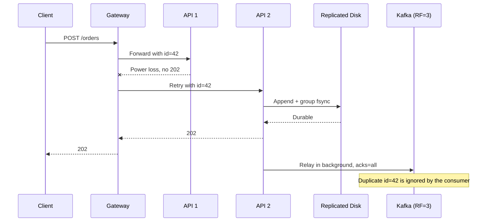
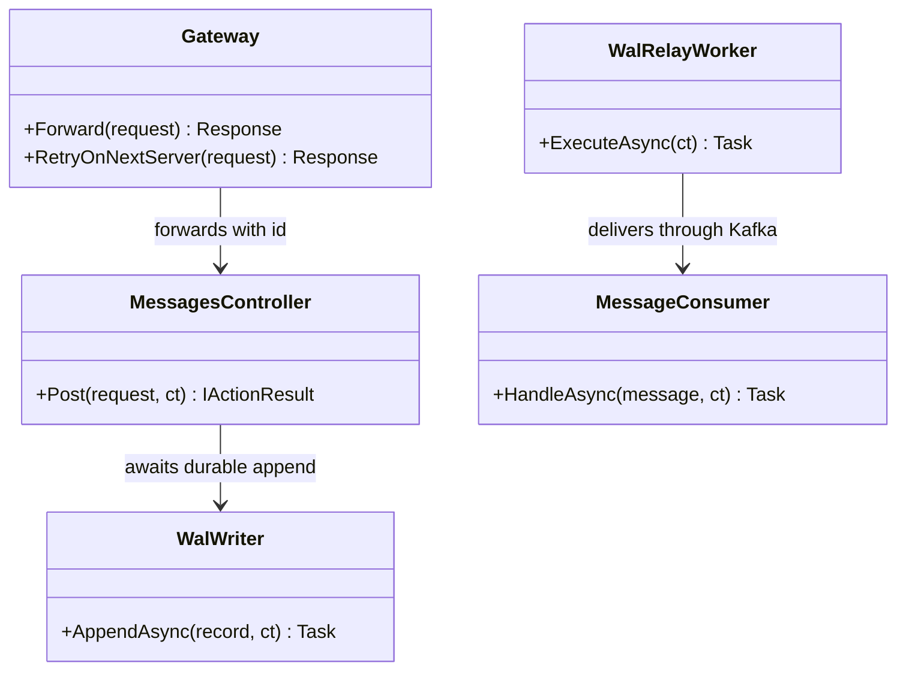
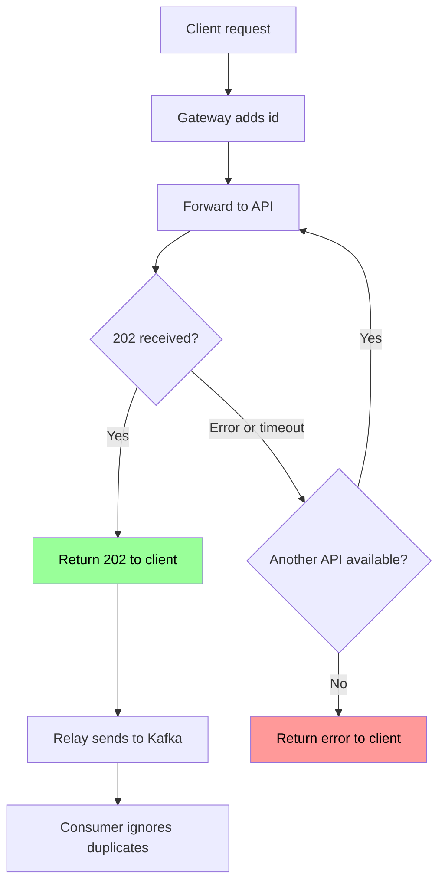

# Gateway مع WAL على قرص منسوخ

## الخطوات

1. ضع Gateway أمام الـ API، ليولّد `id` ثابتاً لكل طلب، مثل `$request_id` في Nginx.
2. فعّل إعادة POST على سيرفر آخر: `proxy_next_upstream error timeout non_idempotent`، مع إبقاء `proxy_request_buffering on`.
3. استخدم Group Commit في الـ API، بكتابة WAL على قرص منسوخ مثل Azure Managed Disk (ZRS).
4. لا ترجع `202` إلا بعد اكتمال `fsync`.
5. يرسل Relay في الخلفية إلى Kafka بـ `acks=all`، مع `RF=3` و`min.insync.replicas=2`، ثم يحفظ الـ checkpoint.
6. إذا توقف السيرفر نهائياً، اربط قرصه بسيرفر آخر ليكمل من الـ checkpoint.
7. عند المستهلك، سجّل الرسالة مع `UNIQUE(id)` في نفس transaction التسجيل.
8. راقب تأخر Relay، وأرجع `503` قبل امتلاء القرص.
9. إذا تعطل Gateway قبل 202، يتلقى العميل خطأ. هذه الحالة لا تغطى إلا بإعادة إرسال من العميل.

## Sequence Diagram

*لاحظ: Gateway هو الذي يعيد المحاولة، والعميل لا يشعر إلا بزمن إضافي.*

## Class Diagram

*لاحظ: `Gateway` هنا مكوّن جاهز مثل Nginx، وليس class تكتبه.*

## Flowchart

*لاحظ: الخطأ يصل إلى العميل فقط بعد فشل كل السيرفرات المتاحة.*

## مثال

الافتراض: 5,000 رسالة/ثانية، و~5ms زمن Group Commit مقاس على SSD محلي، فالطلبات المعلقة = 5,000 × 0.005s = 25 طلباً. القرص المنسوخ أبطأ، فقِسه قبل الاعتماد على هذا الرقم.

| الحدث | القرص المحلي وحده | ✅ هذا الحل |
|---|---|---|
| Crash أو انقطاع كهرباء بعد 202 | 0 مفقود | 0 مفقود |
| تلف القرص أو توقف السيرفر نهائياً | ❌ يفقد غير المرسل أو يبقى عالقاً | 0 مفقود |
| تعطل Kafka | يتراكم في WAL | يتراكم في WAL |
| انقطاع السيرفر قبل 202 (~25 طلباً) | ❌ العميل يتلقى خطأ | Gateway يعيد الإرسال |
| تعطل Gateway قبل 202 | ❌ العميل يتلقى خطأ | ❌ العميل يتلقى خطأ |

حدود إعادة المحاولة في [توثيق Nginx](https://nginx.org/en/docs/http/ngx_http_proxy_module.html): لا يُعاد POST إلا مع `non_idempotent`، ولا يمكن الانتقال إلى سيرفر آخر بعد بدء إرسال الرد إلى العميل.
