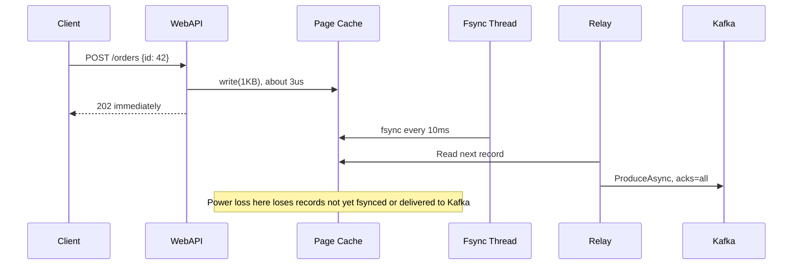
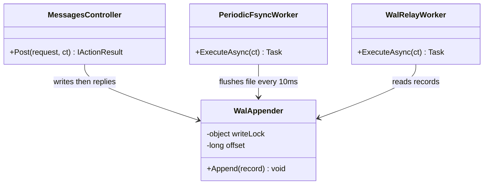
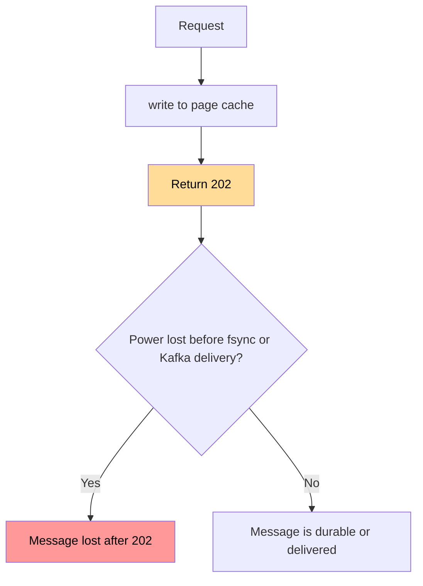

# رد فوري مع fsync دوري

> ❌ هذا الحل لا يحقق شرط عدم فقدان الرسائل، لأن العميل قد يحصل على `202` لرسالة تضيع عند انقطاع الكهرباء.

## الخطوات

1. اكتب الرسالة في ملف WAL بـ `write` داخل قفل قصير، فتصل إلى Page Cache في RAM.
2. أرجع `202` مباشرة، بلا انتظار للقرص أو Kafka.
3. في الخلفية، نفّذ `fsync` كل 10ms لنقل البيانات إلى القرص.
4. يقرأ Relay السجلات بلا انتظار `fsync`، ويرسلها إلى Kafka بـ `acks=all`، ثم يحفظ الـ checkpoint.
5. عند التشغيل، اجعل `checkpoint = min(checkpoint, نهاية الملف)`، لأن الملف قد يقصر بعد انقطاع الكهرباء.
6. أضف UPS يشغّل `Flush` قبل إيقاف السيرفر لتقليل خطر انقطاع الكهرباء.
7. عند المستهلك، تجاهل أي `id` سبق تسجيله.

## Sequence Diagram

*لاحظ: العميل لا ينتظر `fsync` ولا Kafka، وهذا مصدر السرعة والخطر معاً.*

## Class Diagram

*لاحظ: لا يوجد `await` للقرص في مسار الطلب.*

## Flowchart

*لاحظ: الرد يسبق الحفظ، فتوجد نافذة فقدان بعد 202.*

## مثال

قياس فعلي: رسالة 1KB، 5,000 رسالة/ثانية، ثلاث جولات، .NET 10، قرص Kingston SATA SSD، كاتب واحد بلا HTTP أو Kafka.

| الطريقة | زمن القرص قبل الرد p50 | p99 | الحد الأقصى لرسائل غير محفوظة على القرص |
|---|---|---|---|
| ✅ Group commit (للمقارنة) | 4.8–5.0ms | 8.3–10.7ms | 0 بعد 202 |
| رد فوري + `fsync` كل 10ms | 2.5–4.3µs | 17.6–88.8µs | 113–698 |
| رد فوري + `fsync` كل 100ms | 2.4–3.3µs | 14.9–24.7µs | 868–1,170 |

| الحدث | النتيجة |
|---|---|
| Crash للعملية | 0 مفقود، لأن Page Cache بقي سليماً |
| انقطاع الكهرباء أو kernel panic | يفقد غير المحفوظ وغير المرسل |
| تلف القرص | يفقد كل غير المرسل |

إطالة الفترة إلى 100ms تزيد الخطر دون تحسن كبير في الزمن، لذلك فـ10ms أفضل.

## تطبيقات مشابهة

- **Redis (منتج عالمي):** خيار `appendfsync everysec` ينفذ `fsync` في ثريد خلفي، وتوثيقه يذكر احتمال فقدان ثانية من الكتابات تقريباً. [المرجع](https://redis.io/docs/latest/operate/oss_and_stack/management/persistence/)
