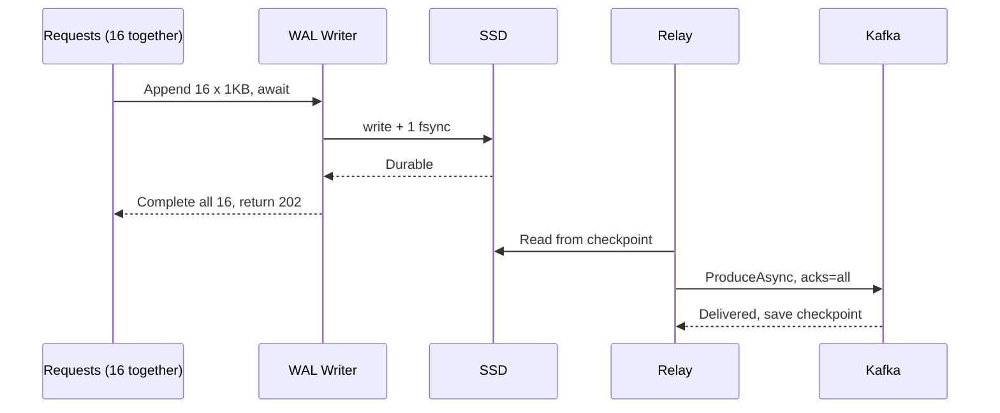
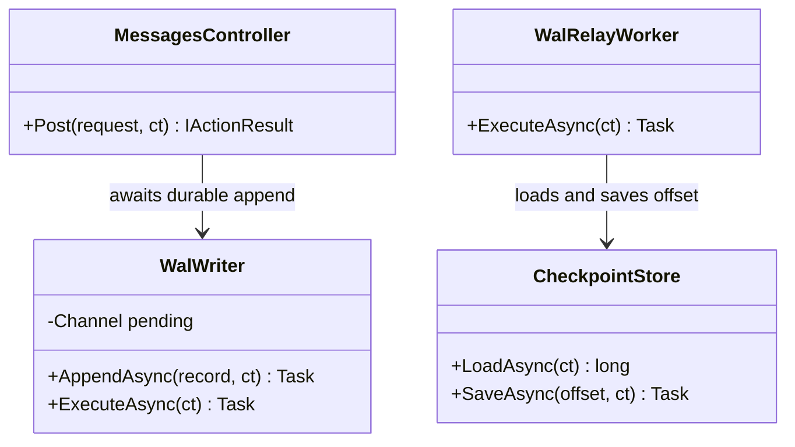
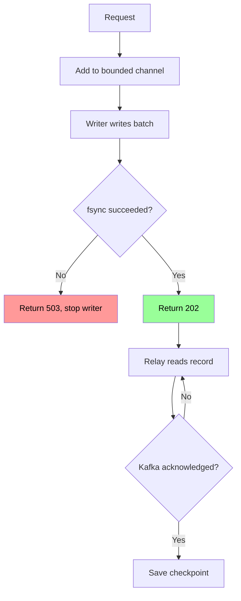

# ملف محلي مع Group Commit

## الخطوات

1. خصص ملف WAL، وهو ملف نضيف إلى نهايته فقط، على قرص دائم.
2. اكتب كل سجل بالشكل: `Length` ثم `CRC` ثم `Payload`.
3. يضع الطلب رسالته في `Channel` محدود، ثم ينتظر بـ `await`، فيعود ثريده إلى الـ pool.
4. يقرأ كاتب واحد كل الرسائل المنتظرة، ويكتبها، ثم ينفذ `fsync` واحداً لها جميعاً.
5. بعد اكتمال `fsync`، يكمل الكاتب كل الطلبات المنتظرة، فيرجع كل منها `202`.
6. إذا فشل `fsync`، تُرفض كل رسائل الدفعة بـ `503` ويتوقف الكاتب، لأن حالة الملف لم تعد مضمونة.
7. يقرأ Relay من الـ checkpoint ويرسل إلى Kafka بـ `acks=all`.
8. بعد تأكيد Kafka، يحفظ Relay الـ checkpoint، ثم تُحذف الملفات المرسلة بالكامل.
9. عند التشغيل، يفحص النظام آخر سجل بـ CRC، ويحذف السجل الناقص، ثم يكمل Relay من الـ checkpoint.
10. عند المستهلك، تجاهل أي `id` سبق تسجيله.

## Sequence Diagram


*لاحظ: `fsync` واحد يخدم 16 طلباً، وهذا مصدر السرعة.*

## Class Diagram


*لاحظ: الطلب لا يعرف Kafka، والـ Relay لا يعرف الطلبات.*

## Flowchart


*لاحظ: الوعد للعميل يبدأ بعد `fsync`، لا عند وصول الطلب.*

## مثال

قياس فعلي: رسالة 1KB، ثلاث جولات، .NET 10، قرص Kingston SATA SSD، بلا HTTP أو Kafka.

| الطريقة | p50 | p99 | المعدل |
|---|---|---|---|
| ❌ `fsync` لكل رسالة | 2.0–2.3ms | 4–5.6ms | 387–437/ثانية فقط |
| ✅ Group commit عند 5,000/ثانية | 4.8–5.0ms | 8.3–10.7ms | 5,000/ثانية، ~16 رسالة لكل `fsync` |
| Group commit عند 20,000/ثانية | 4.2–4.9ms | 8.5–72.8ms | 20,000/ثانية، غير مستقر في p99 |

كيف تتكون الدفعة عند 5,000/ثانية: تصل رسالة كل 0.2ms، وتستغرق الدورة ~3.2ms.

```
t=0.0ms  يبدأ fsync #1
t=0–3.2  تصل 16 رسالة وتنتظر في الـ Channel
t=3.2ms  ينتهي fsync #1، تُكتب الـ 16 رسالة ويبدأ fsync #2
t=6.4ms  ينتهي fsync #2، وتحصل الـ 16 رسالة على 202 معاً
```
متوسط الانتظار = (6.4 + 3.2) ÷ 2 = 4.8ms، وهو قريب من القياس.

شكل السجل:

```
┌ Length 4B ┬ CRC 4B ┬ Payload 1024B ┐ = 1032B
```

ماذا يحدث عند الانهيار:

| لحظة الانهيار | النتيجة |
|---|---|
| قبل اكتمال `fsync` | لا 202، وCRC يحذف السجل الناقص |
| بعد 202 وقبل الإرسال | Relay يرسلها بعد التشغيل، ولا فقدان |
| بعد الإرسال وقبل حفظ الـ checkpoint | تكرار، والمستهلك يتجاهله |
| ❌ تلف القرص قبل الإرسال | الرسائل غير المرسلة تضيع |

## تطبيقات مشابهة

- **PostgreSQL (مشروع مفتوح المصدر عالمي):** يستخدم group commit لجمع عدة transactions في عملية flush واحدة على WAL. [المرجع](https://www.postgresql.org/docs/current/wal-configuration.html)
- **Vector من Datadog (الولايات المتحدة):** يخزن الأحداث في disk buffer محلي قبل إرسالها إلى الوجهة. [المرجع](https://vector.dev/highlights/2022-02-08-disk-buffer-v2-beta/)
