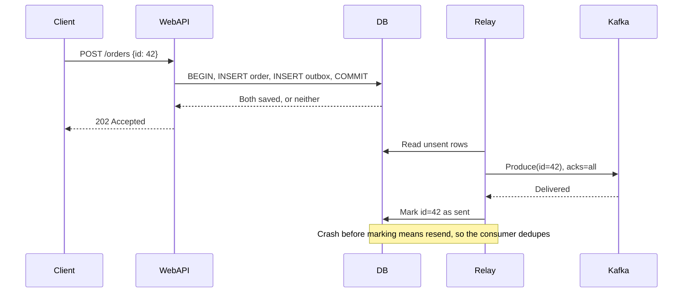
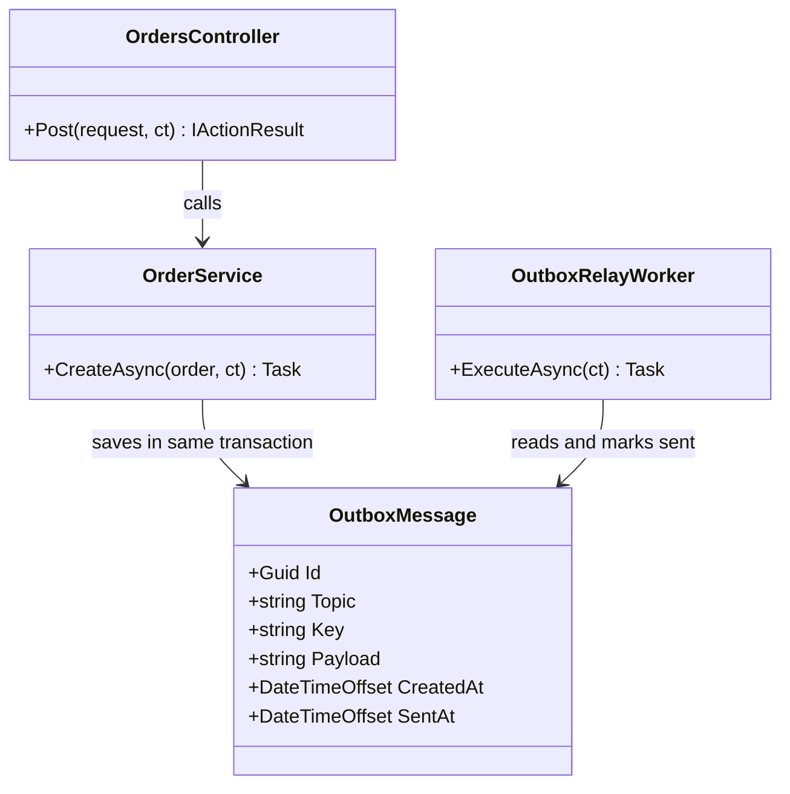
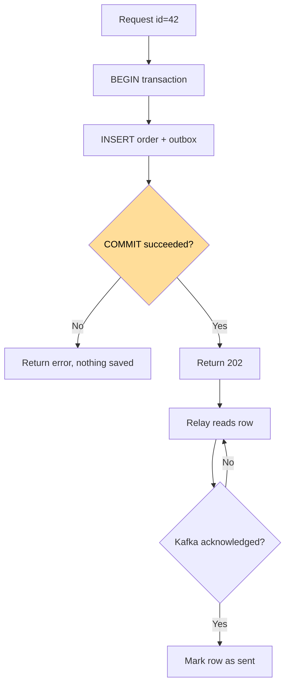

# Outbox Pattern

## الخطوات

1. أنشئ جدول `outbox` في نفس قاعدة بيانات العمل، بالأعمدة: `id`، `topic`، `key`، `payload`، `created_at`.
2. افتح transaction واحدة، واكتب فيها بيانات العمل وصف الـ `outbox` معاً.
3. نفّذ `COMMIT`، ثم أرجع `202` للعميل.
4. انقل صفوف الـ `outbox` إلى Kafka عبر Relay، إما بـ polling أو عبر CDC مثل Debezium الذي يقرأ log قاعدة البيانات.
5. أرسل بإعدادات `acks=all` و`enable.idempotence=true`.
6. بعد تأكيد Kafka، علّم الصف كمرسل أو احذفه.
7. احذف الصفوف القديمة دورياً، أو قسّم الجدول إلى partitions زمنية.
8. عند المستهلك، تجاهل أي `id` سبق تسجيله، لأن انهيار Relay قبل الخطوة 6 يعيد الإرسال.

## Sequence Diagram


*لاحظ: قيمة النمط في الـ transaction المشتركة، لا في مكان التخزين.*

## Class Diagram


*لاحظ: `OrderService` وحده يكتب الصف، و`OutboxRelayWorker` وحده يرسله.*

## Flowchart


*لاحظ: `COMMIT` هو نقطة القرار الوحيدة، وبعدها يبقى Relay يعيد المحاولة حتى ينجح.*

## مثال

الافتراض: 5,000 رسالة/ثانية، و1KB للرسالة. الأرقام محسوبة.

| البند | القيمة |
|---|---|
| كتابات الجدول | 5,000 `INSERT`/ثانية إضافية |
| النمو اليومي | 5,000 × 86,400 = 432 مليون صف |
| حجم البيانات اليومي | 432GB قبل الفهارس |

الفرق عند انهيار السيرفر بين الخطوتين:

```
بدون Outbox:
t=0  COMMIT الطلب 42    ✅
t=1  crash              💥
t=2  الإرسال إلى Kafka  لم يحدث
t=3  الطلب محفوظ، والرسالة لن تصل أبداً

مع Outbox:
t=0  COMMIT الطلب 42 + صف outbox  ✅
t=1  crash                        💥
t=2  إعادة التشغيل، وRelay يقرأ الصف
t=3  الرسالة تصل إلى Kafka        ✅
```

## تطبيقات مشابهة

- **Clear Street (الولايات المتحدة):** بنت Outbox فوق Debezium وKafka، وتصف تشغيله في الإنتاج. [المرجع](https://www.clearstreet.io/insights/transactional-outboxes)
- **SeatGeek (الولايات المتحدة):** تشرح تصميمها للنمط باستخدام Outbox Event Router من Debezium. [المرجع](https://chairnerd.seatgeek.com/transactional-outbox-pattern)
