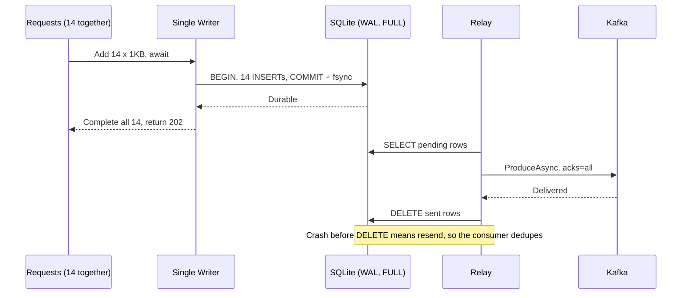
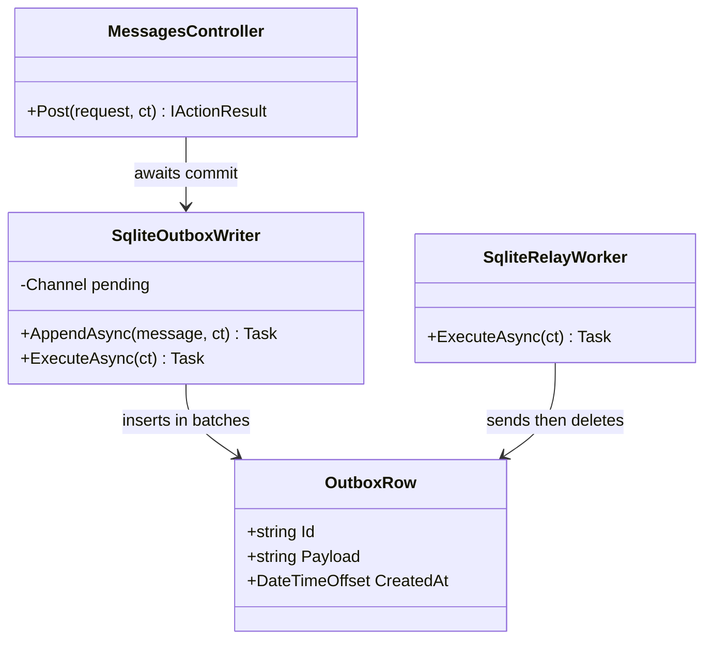
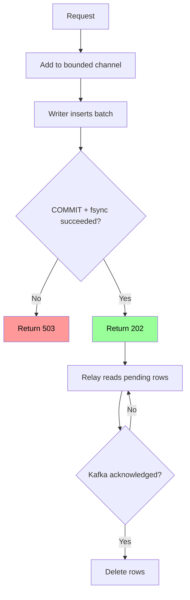

# SQLite كـ Outbox محلي

## الخطوات

1. استخدم هذا الحل إذا كان الـ API يمرر الرسالة بلا بيانات عمل في DB أخرى، لأن الكتابة في SQLite وDB أخرى تعيد مشكلة dual write.
2. خصص لكل instance قاعدة SQLite على قرص دائم متصل بها. لا تضعها على NFS أو SMB، لأن وضع WAL في SQLite لا يعمل على نظام ملفات شبكي.
3. فعّل `PRAGMA journal_mode=WAL` و`PRAGMA synchronous=FULL`، حتى ينفذ SQLite `fsync` بعد كل `COMMIT`.
4. أنشئ جدول `outbox` بالأعمدة: `id`، `payload`، `created_at`.
5. يضع الطلب رسالته في `Channel` محدود، ثم ينتظر بـ `await`.
6. يقرأ كاتب واحد كل الرسائل المنتظرة، ويكتبها في transaction واحدة، لأن SQLite يسمح بكاتب واحد فقط لكل قاعدة.
7. بعد `COMMIT`، تحصل كل طلبات الدفعة على `202`. وعند فشله، تحصل على `503`.
8. يقرأ Relay الصفوف، ويرسلها إلى Kafka بـ `acks=all`، وينتظر التأكيد، ثم يحذفها.
9. عند الحاجة إلى معدل أعلى، قسّم الرسائل على عدة ملفات SQLite، وراقب حجم الملفات.
10. عند المستهلك، تجاهل أي `id` سبق تسجيله، لأن الانهيار قبل الحذف يعيد الإرسال.

## Sequence Diagram

*لاحظ: transaction واحدة تخدم 14 طلباً، فلا يحتاج كل طلب إلى `fsync` مستقل.*

## Class Diagram

*لاحظ: يوجد كاتب واحد للإدراج، وRelay منفصل للإرسال والحذف.*

## Flowchart

*لاحظ: الصف لا يُحذف إلا بعد تأكيد Kafka.*

## مثال

قياس فعلي: رسالة 1KB، ثلاث جولات، .NET 10، `Microsoft.Data.Sqlite`، قرص Kingston SATA SSD، بلا HTTP أو Kafka.

| الطريقة | p50 | p99 | المعدل | انقطاع الكهرباء بعد 202 |
|---|---|---|---|---|
| ❌ `FULL`، transaction لكل رسالة | 2.9–3.3ms | 6–15.2ms | 232–324/ثانية فقط | 0 مفقود |
| ✅ `FULL`، group commit عند 5,000/ثانية | **4.1ms** | 17.5–25.9ms | 5,000/ثانية، ~14 رسالة لكل commit | **0 مفقود** |
| ❌ `NORMAL`، transaction لكل رسالة | 20–35µs | 162–321µs | 4,002–13,685/ثانية | قد تُلغى commits حديثة |

في `NORMAL`، بلغ أبطأ `INSERT` بين 0.16 و1.74 ثانية. وعند `SIGKILL` بعد 15,000 رسالة، لم تضع أي رسالة في 3 محاولات، وهذا يوافق توثيق SQLite بأن الـ transactions تنجو من crash التطبيق في كل الأوضاع.

| الحدث | SQLite `FULL` مع group commit |
|---|---|
| Crash أو انقطاع كهرباء بعد 202 | 0 مفقود |
| Crash قبل `DELETE` | تكرار، والمستهلك يتجاهله |
| تعطل Kafka | تتراكم الصفوف وينمو الملف |
| ❌ تلف القرص قبل الإرسال | الرسائل غير المرسلة تضيع |

المراجع: [synchronous في SQLite](https://www.sqlite.org/pragma.html#pragma_synchronous)، [وضع WAL](https://www.sqlite.org/wal.html).

## تطبيقات مشابهة

- **Zapier (الولايات المتحدة):** استخدمت SQLite كـ Outbox محلي قبل Kafka، مع وضع WAL و50 ملفاً لكل pod، عند ذروة تقارب 15,000 حدث/ثانية. عدّت قرص EBS نقطة فشل رئيسية، ثم انتقلت لاحقاً إلى تصميم آخر. [المرجع](https://zapier.com/blog/lessons-from-using-outbox-pattern-at-scale)
