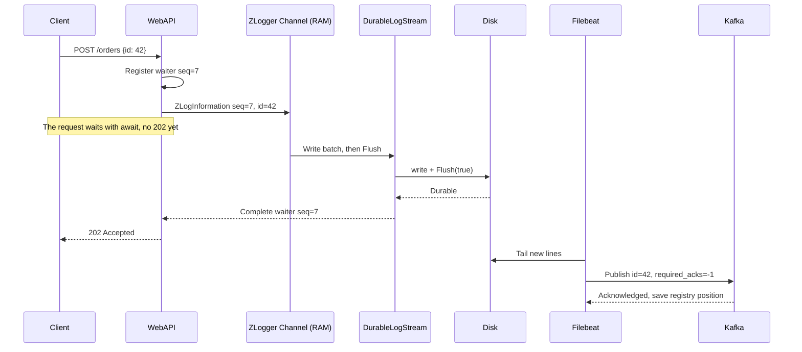
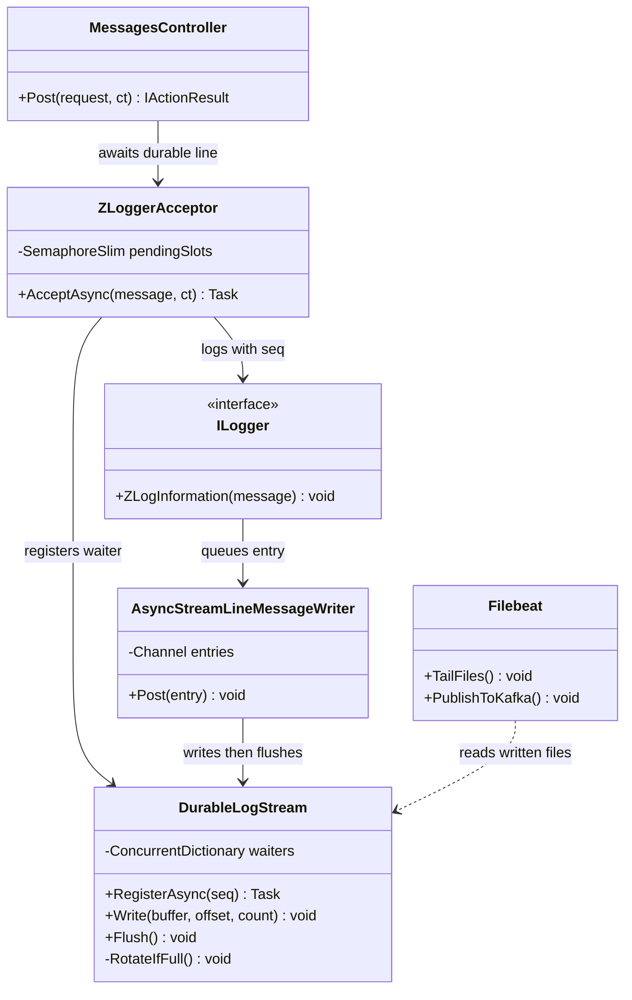
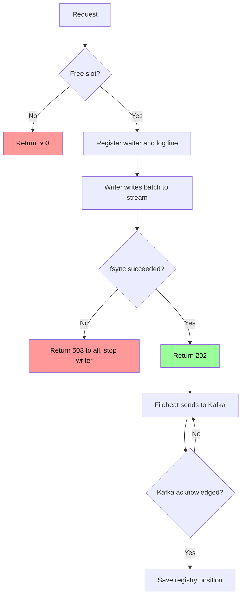

# ZLogger مع fsync ثم Relay إلى Kafka

> هذا التصميم يؤخر `202` إلى ما بعد `fsync`، فلا تضيع رسالة حصلت على `202` إلا عند تلف القرص قبل الإرسال. الكود في `demo/solutions/zlogger`، ويعمل بـ `--solution=s6`. لم يُختبر انقطاع كهرباء حقيقي، ولم يُطبق حذف الملفات المرسلة بعد.

## الخطوات

1. أضف ZLogger عبر `AddZLoggerStream`، وليس `AddZLoggerFile`، حتى يكتب في `DurableLogStream` الخاص بنا. لا يوفر ZLogger `fsync` ولا طريقة لانتظار الحفظ، لأن `ZLogInformation` يرجع `void`.
2. اضبط `FullMode = Block`، واجعل `BackgroundBufferCapacity` أكبر من أو يساوي حد الطلبات المعلقة، حتى لا يحجز `PostSlow` ثريد الطلب بـ `Wait`.
3. قبل التسجيل، يحجز الطلب مكاناً من حد الطلبات المعلقة، وعند امتلائه يرجع `503`.
4. يأخذ الطلب رقم `seq` فريداً، ويسجل منتظراً له، ثم ينفذ `ZLogInformation` بسطر JSON يبدأ بـ `seq`، وينتظر بـ `await` مع timeout.
5. يكتب الكاتب الخلفي في ZLogger الدفعة إلى `DurableLogStream.Write`، ثم يستدعي `Flush`.
6. يقرأ `Write` أرقام `seq` من الأسطر المكتملة فقط، لأن ZLogger قد يقسم السطر بين استدعاءين.
7. ينفذ `Flush` عملية `Flush(true)` على الملف، وبعد نجاحها فقط يكمل منتظري هذه الأسطر، فيرجع كل طلب `202`.
8. عند فشل `fsync`، يرفض `DurableLogStream` كل المنتظرين بـ `503` ويتوقف، لأن ZLogger يبتلع الاستثناء ثم يكمل حلقته.
9. عند timeout، أرجع `503` واحذف المنتظر. قد يكون السطر قد كُتب، فقد تصل الرسالة رغم `503`.
10. افتح ملفاً جديداً عند كل تشغيل وعند بلوغ حد الحجم، ثم نفّذ `fsync` على المجلد، حتى لا يختفي الملف بعد انقطاع الكهرباء. لا تُكمل الكتابة في ملف قديم، لأن موضع Filebeat قد يكون أبعد من نهايته بعد الانقطاع، فيتخطى أسطراً جديدة.
11. يقرأ Filebeat الملفات، ويرسل إلى Kafka بـ `required_acks: -1`، ويحفظ موضع القراءة في registry بعد التأكيد.
12. لا تحذف ملفاً قبل أن يؤكد registry إرسال نهايته، فحذفه المبكر قد يفقد رسائله.
13. عند إيقاف الخدمة، نفّذ `Dispose` للـ `LoggerFactory` لإكمال ما في الذاكرة.
14. عند المستهلك، تجاهل أي `id` سبق تسجيله، لأن Filebeat يضمن at-least-once، وقد يقرأ سطراً قبل `fsync`.

## Sequence Diagram


*لاحظ: `202` يأتي بعد `fsync`، والسطر في الـ Channel لم يعد وعداً للعميل.*

## Class Diagram


*لاحظ: `DurableLogStream` يضيف ما ينقص ZLogger: `fsync` وإخبار الطلب بنتيجته.*

## Flowchart


*لاحظ: لا يوجد مسار إلى `202` يتجاوز `fsync`.*

## مثال

الضبط القديم، قبل هذا التصميم. قياس فعلي: رسالة 1KB، .NET 10، ZLogger 2.5.10، قرص Kingston SATA SSD، بلا HTTP أو Kafka.

```
t=0  استدعاءات ZLogInformation تضع 15,000 رسالة في Channel، وكلها تحصل على 202
t=1  الكاتب الخلفي أنهى 9,944 رسالة فقط
t=2  SIGKILL 💥
t=3  ❌ 5,056 رسالة ضاعت (34%) في كل المحاولات الـ5
```

| لحظة الانهيار | ❌ الضبط القديم | ✅ هذا التصميم |
|---|---|---|
| السطر في الـ Channel | ضاع بعد `202` | لا `202`، والعميل يرى خطأ اتصال |
| السطر في Page Cache، انقطاع كهرباء | ضاع بعد `202` | لا `202`، والعميل يرى خطأ اتصال |
| بعد `fsync` وقبل رجوع `202` | لا ينطبق | لا `202`، وقد تصل الرسالة |
| بعد `202` وقبل إرسال Filebeat | ضاع إن لم يصل إلى القرص | Filebeat يرسلها بعد التشغيل |
| بعد إرسال Filebeat وقبل حفظ registry | تكرار | تكرار، والمستهلك يتجاهله |
| ❌ تلف القرص قبل الإرسال | ضاع | ضاع |

قياس فعلي للـ API كامل مع Kafka وFilebeat: 10,000 طلب، وسيط 3 جولات، على لابتوب، بلا أعطال، وبلا رسائل مفقودة. جولات الضبط القديم من يوم آخر، فالمقارنة تقريبية:

| بلا تحديد معدل، 256 طلباً متزامناً | p50 | p95 | p99 | الإنتاجية |
|---|---|---|---|---|
| ❌ الضبط القديم | 40ms | 113ms | 158ms | ≈5,048/ثانية |
| ✅ هذا التصميم | 59ms | 118ms | 162ms | ≈3,836/ثانية |

| معدل مستهدف 5,000/ثانية | p50 | p95 | p99 | الإنتاجية |
|---|---|---|---|---|
| ❌ الضبط القديم | 35ms | 381ms | 517ms | ≈4,922/ثانية |
| ✅ هذا التصميم | 579ms | 768ms | 862ms | ≈4,177/ثانية |

لم يبلغ هذا التصميم 5,000/ثانية على هذا الجهاز، فتراكمت الطلبات وارتفع زمنها.

ما تم التحقق منه:

| الفحص | النتيجة |
|---|---|
| `strace` لطلب واحد | `pwrite64` ثم `fsync` ثم `202` |
| `SIGKILL` أثناء دفعة 15,000 طلب | كل رسالة حصلت على `202` موجودة في الملف |
| فشل `fsync` مُحاكى | كل المنتظرين رُفضوا، وكذلك الطلبات اللاحقة |

❌ `SIGKILL` يترك Page Cache سليماً، فلا يثبت النجاة من انقطاع الكهرباء. هذه النجاة تعتمد على ترتيب `fsync` أعلاه وعلى صدق القرص.

يقسم ZLogger الدفعة عند حد 65,536 بايت، وينفذ `Flush` لكل جزء، فيصبح كل جزء `fsync` مستقلاً. الأرقام التالية محسوبة بدورة 3.2ms المقاسة في `local-wal-group-commit.md` وسطر 1KB:

| المعدل | أسطر كل دورة | حجمها | عدد `fsync` في الدورة |
|---|---|---|---|
| 5,000/ثانية | 16 | ~16KB | 1 |
| 20,000/ثانية | 64 | ~64KB | 1–2 |
| 100,000/ثانية | 320 | ~320KB | 5 أو أكثر، فتطول الدورة |

لذلك تقارب الطاقة ~19,700 رسالة/ثانية لكل قرص (63 سطراً ÷ 3.2ms)، قبل حساب HTTP.

لا يحتوي الكود المصدري لـ ZLogger 2.6.1 (commit `8287fee`) على `Flush(true)` أو `FlushToDisk`، وحلقته تمرر الاستثناء إلى `InternalErrorLogger` ثم تكمل، لذلك نضع `fsync` ومعالجة فشله في `DurableLogStream`.

## تطبيقات مشابهة

- **Filebeat من Elastic (منتج عالمي):** يقرأ ملفات السجلات ويرسلها بضمان at-least-once من لحظة قراءتها، ولا يغطي ما لم يصل إلى الملف. [المرجع](https://www.elastic.co/guide/en/beats/filebeat/current/how-filebeat-works.html)
