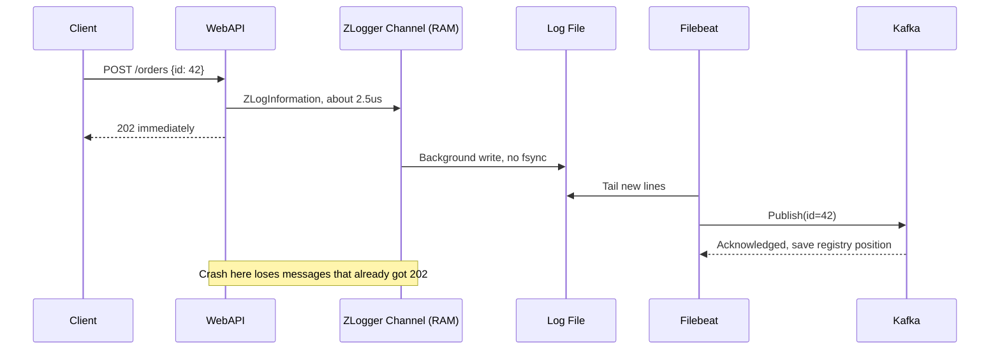
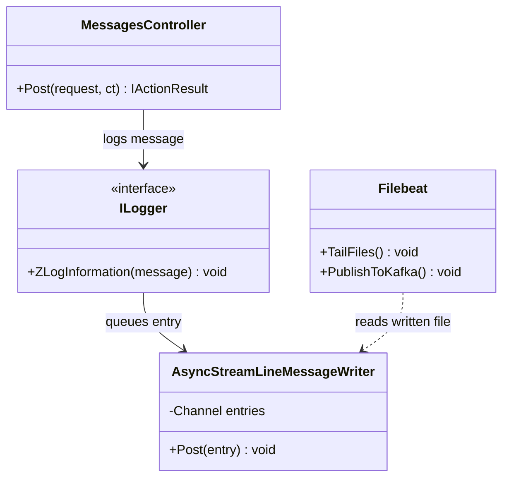
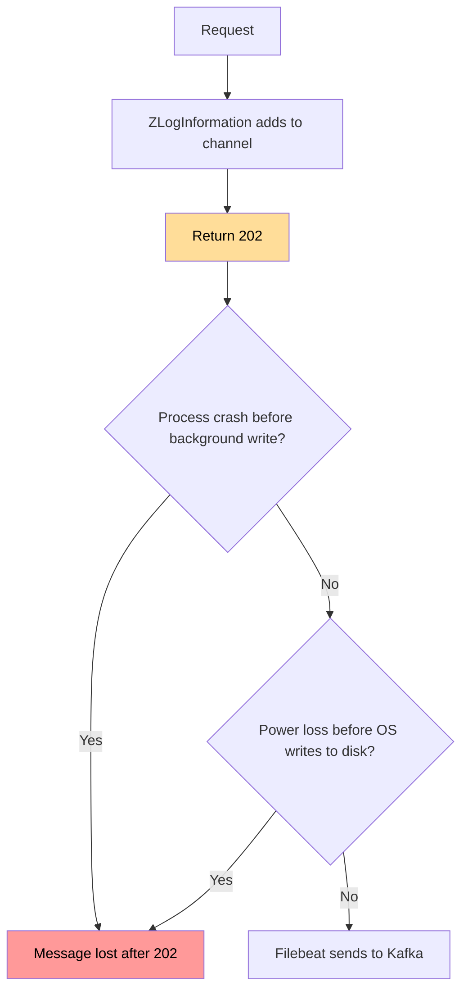

# ZLogger مع ملف ثم Relay إلى Kafka

> ❌ هذا الحل لا يحقق شرط عدم فقدان الرسائل، لأن ZLogger لا يؤكد حفظ السطر عند رجوع الاستدعاء، ولا ينفذ `fsync`.

## الخطوات

1. أضف ZLogger، وهو logger سريع لـ .NET يكتب في الخلفية، عبر `AddZLoggerRollingFile` بتنسيق JSON.
2. اضبط `FullMode = Block` حتى لا تُحذف الرسائل عند امتلاء المخزن. القيمة الافتراضية `Grow` تترك الذاكرة تنمو بلا حد، و`Drop` يحذف الرسائل.
3. داخل الطلب، نفّذ `logger.ZLogInformation` بالرسالة و`id` الخاص بها، ثم أرجع `202`.
4. يقرأ Filebeat الملفات، ويرسل إلى Kafka، ويحفظ موضع القراءة في registry.
5. لا تحذف ملفاً قبل أن يكمل Filebeat قراءته، فحذفه المبكر قد يفقد رسائله.
6. عند إيقاف الخدمة، نفّذ `Dispose` للـ `LoggerFactory` لإكمال ما في الذاكرة.
7. عند المستهلك، تجاهل أي `id` سبق تسجيله، لأن Filebeat يضمن at-least-once.

## Sequence Diagram


*لاحظ: 202 يخرج والرسالة ما زالت في الذاكرة.*

## Class Diagram


*لاحظ: `ZLogInformation` يرجع `void`، فلا توجد طريقة لانتظار نتيجة الحفظ.*

## Flowchart


*لاحظ: توجد نافذتا فقدان بعد 202: الذاكرة، ثم Page Cache.*

## مثال

قياس فعلي: رسالة 1KB، .NET 10، ZLogger 2.5.10، قرص Kingston SATA SSD، بلا HTTP أو Kafka.

| الاختبار | النتيجة |
|---|---|
| زمن الاستدعاء عند 5,000/ثانية | p50 = 2.3–2.5µs، p99 = 7.4–10.3µs |
| إيقاف سليم مع `Dispose` | 25,000 من 25,000 على القرص |
| `SIGKILL` بعد 15,000 رسالة بمعدل 5,000/ثانية | 0 مفقود في 5 محاولات، وهذا لا يثبت أن الفقدان مستحيل |
| ❌ `SIGKILL` بعد دفعة 15,000 رسالة بأقصى سرعة | **5,056 مفقودة** في كل المحاولات الـ5 |

عند الضغط المفاجئ يسبق المنتج الكاتب الخلفي، فتتراكم الرسائل في الذاكرة:

```
t=0  استدعاءات ZLogInformation تضع 15,000 رسالة في Channel
t=1  الكاتب الخلفي أنهى 9,944 رسالة فقط
t=2  SIGKILL 💥
t=3  النتيجة: 5,056 رسالة ضاعت (34%)
```

لا يحتوي الكود المصدري لـ ZLogger (commit `8287fee`) على `Flush(true)` أو `FlushToDisk`، فلا يوجد `fsync` صريح، وانقطاع الكهرباء قد يفقد ما بقي في Page Cache.

## تطبيقات مشابهة

- **Filebeat من Elastic (منتج عالمي):** يقرأ ملفات السجلات ويرسلها بضمان at-least-once من لحظة قراءتها، ولا يغطي ما لم يصل إلى الملف. [المرجع](https://www.elastic.co/guide/en/beats/filebeat/current/how-filebeat-works.html)
